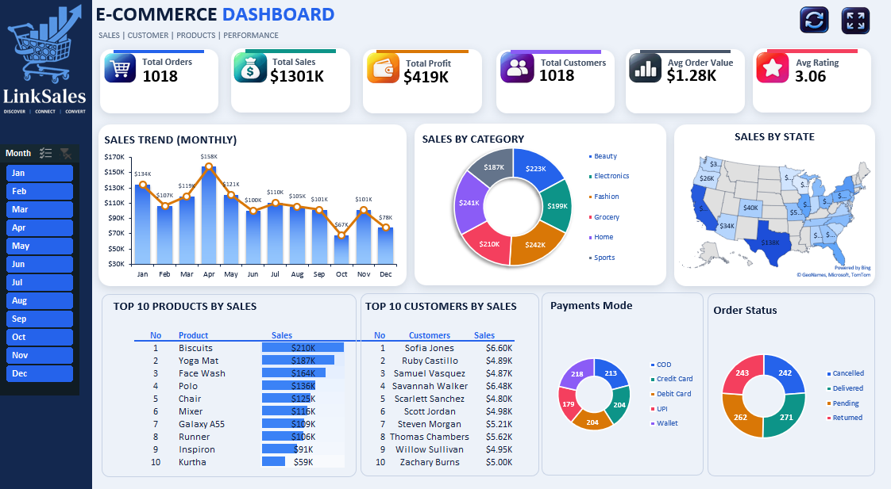
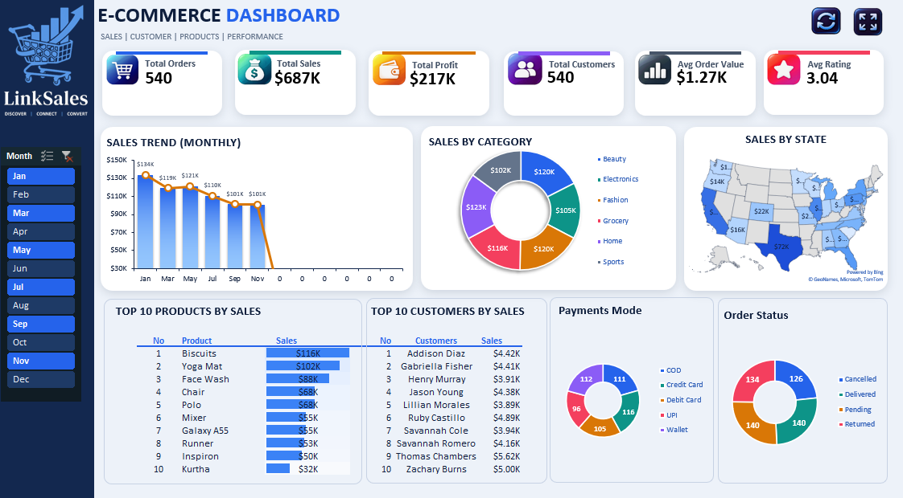
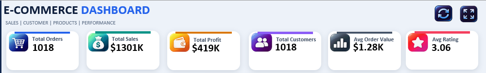
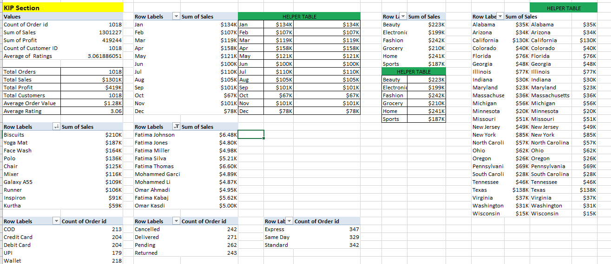

# E-Commerce Sales Dashboard (Excel)



An interactive sales dashboard built entirely in Microsoft Excel. It turns 1,018 raw e-commerce transactions into a single page that shows how the business is performing, and lets you explore it month by month.

**Highlights:** $1.30M in sales · $419K profit · $1,278 average order value · 3.06 average rating (all months).

---

## Table of contents

- [Overview](#overview)
- [What the dashboard shows](#what-the-dashboard-shows)
- [How to use it](#how-to-use-it)
- [Design](#design)
- [How it works](#how-it-works)
- [Dataset](#dataset)
- [Tools used](#tools-used)
- [Preview](#preview)
- [Project structure](#project-structure)
- [Getting started](#getting-started)
- [Notes and limitations](#notes-and-limitations)
- [Future improvements](#future-improvements)
- [Author](#author)

---

## Overview

Transaction data is hard to read row by row. The goal of this project was to organize that data and build one dashboard where the key numbers, trends and rankings can be understood at a glance, without opening the raw data.

The workbook covers the whole path from data to decision: a data sheet, PivotTables for the calculations, `GETPIVOTDATA` formulas to feed the dashboard, and charts, tables and a slicer for the visuals.

## What the dashboard shows

**Six KPI cards**
- Total Orders
- Total Sales
- Total Profit
- Total Customers
- Average Order Value
- Average Rating

**Analysis panels**
- Monthly sales trend (columns + line)
- Sales by category (doughnut chart)
- Sales by state (filled map)
- Top 10 products by sales (ranked table with in-cell bars)
- Top 10 customers by sales
- Payment method analysis
- Order status analysis

## How to use it

- **Month slicer:** click a month (or hold `Ctrl` to pick several) and the KPIs, charts and tables update together. Use the clear-filter icon to go back to all months.
- **Refresh button:** recalculates the PivotTables after the data changes.
- **Full-screen button:** hides the ribbon so the dashboard fills the screen.

The two buttons are small VBA macros, so open the file with macros enabled.

## Design

The dashboard uses a clean "midnight blue" look:

- A deep navy sidebar with the logo and the month slicer.
- White cards with soft shadows on a light blue-grey background.
- One blue accent for titles, table headers, bars and the map, plus a distinct colour on top of each KPI card (blue, teal, amber, violet, slate, rose).
- A consistent six-colour palette across the doughnut charts, and flat blue in-cell bars in the ranking table.
- The palette is stored in the workbook theme (**Page Layout → Colors**), so it can be changed in one place.

## How it works

```text
EcommerceData sheet (raw transactions)
        │
        ▼
Pivot sheet (PivotTables, connected to the month slicer)
        │   GETPIVOTDATA
        ▼
Dashboard sheet (KPI cards, charts, ranked tables, slicer)
```

1. The `EcommerceData` sheet holds the transactions as an Excel table.
2. The `Pivot` sheet summarizes them with PivotTables (by month, category, state, product, customer, payment mode and order status).
3. `GETPIVOTDATA` formulas read the pivot results and feed the ranked tables and KPI cards.
4. The `Dashboard` sheet displays everything, and the month slicer is connected to all of the PivotTables.

## Dataset

The project uses an e-commerce transaction dataset with 1,018 orders and 28 columns, covering orders, customers, products, locations, payments, shipping, sales, profit, ratings and order status.

Main fields: `Order id`, `Order Date`, `Customer ID`, `Customer Name`, `Product Name`, `Category`, `Sub Category`, `State`, `City`, `Gender`, `Age`, `Quantity`, `Discount %`, `Payment Mode`, `Order Status`, `Unit Price`, `Cost`, `Sales`, `Profit`, `Ratings`, `Delivery Days`, `Quarter`, `Year` and `Month`.

## Tools used

- Microsoft Excel (PivotTables, `GETPIVOTDATA`, formulas)
- Slicers
- Charts, including a filled map chart
- Conditional formatting (data bars)
- VBA (two buttons: refresh and full screen)
- Dashboard design

## Preview

### Dashboard overview


The main page brings the KPIs, trend, category split, state map, rankings, payments and order status together in one view.

### Interactive dashboard


The same dashboard filtered to a single month with the slicer.

### Sales analysis


Trends, categories, products, customers and overall sales performance.

### Supporting Excel analysis


The PivotTables and calculations behind the dashboard.

## Project structure

```text
ecommerce-sales-dashboard-excel/
├── README.md
├── Excel/
│   └── Ecommerce_Sales_Dashboard.xlsm
└── Screenshots/
    ├── 01-dashboard-overview.png
    ├── 02-dashboard-interactive.png
    ├── 03-sales-analysis.png
    └── 04-data-analysis.png
```

## Getting started

1. Download `Ecommerce_Sales_Dashboard.xlsm`.
2. Open it in **desktop Microsoft Excel** (Windows or Mac, Excel 2019 or Microsoft 365).
3. If Excel shows **Protected View**, click **Enable Editing**, then **Enable Content** so the buttons work.
4. Go to the **Dashboard** sheet and use the month slicer.

## Notes and limitations

- The **filled map** needs Excel 2019 or Microsoft 365 and an internet connection to draw. Older versions and Excel for the web show a placeholder instead.
- Slicers and PivotTable refresh work best in desktop Excel. Excel for the web does not run the macro buttons.
- After changing the data, press **Refresh** on the dashboard (or **Data → Refresh All**) to update the PivotTables.

## Future improvements

This project is currently focused on Excel. As I develop my data analytics skills, I plan to extend it with SQL as a data source, an automated data refresh, a Power BI version of the dashboard, and Python for deeper analysis.

## Author

**Fatima Kassidi**

Data Analytics | Excel | SQL | Power BI | Python

---

> Download the workbook and open it in Microsoft Excel to explore the interactive dashboard.
